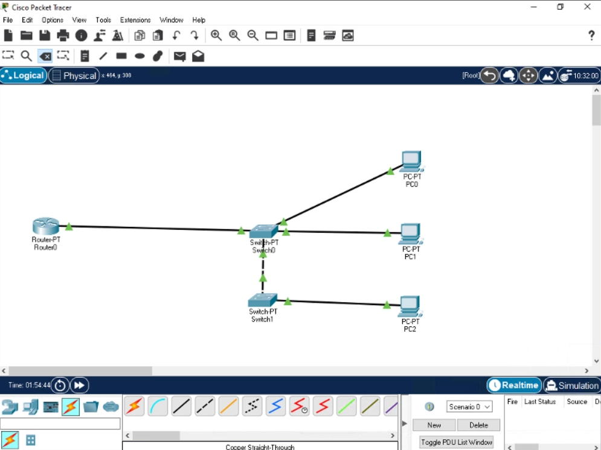
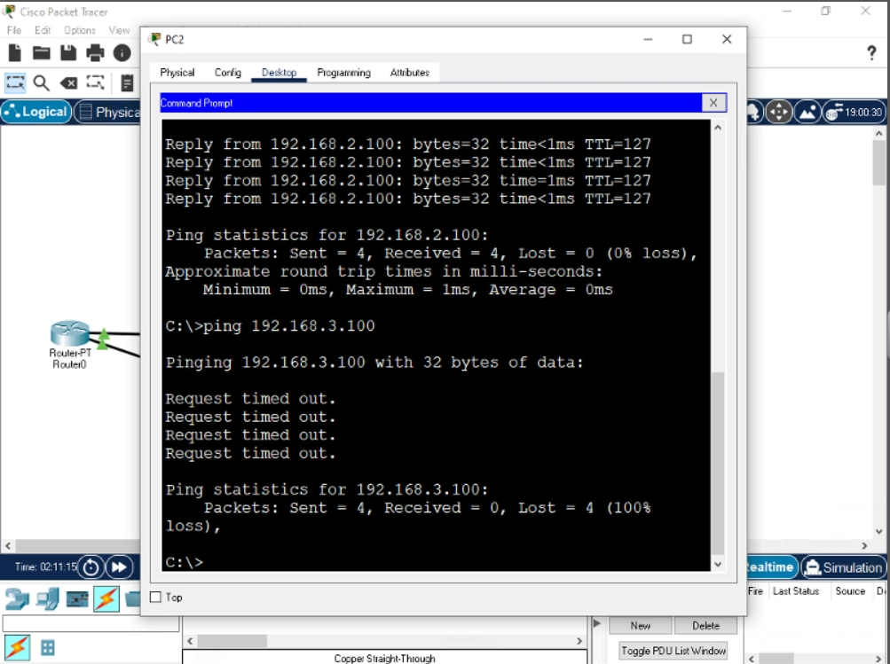

# Lab 8-1: Network Segmentation in Cisco Packet Tracer

A guided lab from my networking course. I built a small network, split it into two subnets, routed between them, and troubleshot a host that couldn't be reached.

## Topology

- 1 router (Router0)
- 2 switches (Switch0, Switch1)
- 3 PCs (PC0, PC1, PC2)
- Copper straight-through cables

## IP Addressing

| Device | Interface | IP Address | Subnet Mask | Default Gateway |
|---|---|---|---|---|
| Router0 | Fa0/0 | 192.168.2.1 | 255.255.255.0 | — |
| Router0 | Fa1/0 | 192.168.3.1 | 255.255.255.0 | — |
| PC0 | Fa0 | 192.168.2.100 | 255.255.255.0 | 192.168.2.1 |
| PC1 | Fa0 | 192.168.3.100 | 255.255.255.0 | — |
| PC2 | Fa0 | 192.168.3.150 | 255.255.255.0 | 192.168.2.1 |

## Router Configuration

```
Router> enable
Router# configure terminal
Router(config)# interface FastEthernet1/0
Router(config-if)# ip address 192.168.3.1 255.255.255.0
Router(config-if)# no shutdown
Router(config-if)# exit
Router(config)# exit
Router# show ip route
```

## Testing

| From | To | Result | Why |
|---|---|---|---|
| PC2 | PC0 (192.168.2.100) | 4/4 replies, TTL=127 | The router has an interface on both subnets. TTL dropped from 128 to 127, showing the packet crossed one router. |
| PC2 | PC1 (192.168.3.100) | 100% loss | PC1 has a 192.168.3.x address but is plugged into Switch0, which is on the 192.168.2.x segment. The router sends 192.168.3.x traffic out Fa1/0 toward Switch1, so it never reaches PC1. |

**Fix:** Move PC1 to Switch1, or give it a 192.168.2.x address with 192.168.2.1 as its gateway.

## What I Learned

- Switches connect devices on the same subnet; routers connect different subnets.
- A router can only reach networks that appear in its routing table (`show ip route`).
- A device's IP address has to match the network segment it's physically connected to.
- TTL in ping replies shows how many routers a packet passed through.




